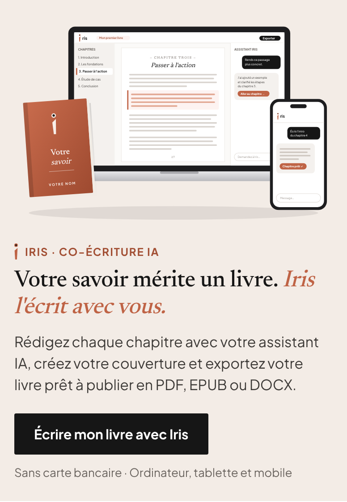

# Bannière Iris pour BoomBooks

Bannière promotionnelle responsive (style « Lisez partout » de Kobo).

- **Ordinateur / tablette (≥ 720 px de large)** : texte à gauche, illustration à droite.
- **Mobile** : illustration en haut, texte en dessous.
- L'adaptation se fait selon la **largeur du bloc** (container queries), pas celle de l'écran :
  elle reste correcte dans une colonne étroite ou une page pleine largeur.
- L'illustration est en SVG intégré : nette sur tous les écrans, sans fichier image à héberger.

## Intégration sur BoomBooks (pour l'agent)

1. Ouvrir `iris-banner.html`.
2. Copier dans le `<head>` du site (ou le CSS global) :
   - la balise `<link … fonts.googleapis.com …>` (polices Newsreader + Plus Jakarta Sans) ;
   - le bloc `<style>` entre `DÉBUT BANNIÈRE IRIS (CSS)` et `FIN BANNIÈRE IRIS (CSS)`.
3. Coller la `<section class="iris-promo">` (entre `DÉBUT/FIN BANNIÈRE IRIS (HTML)`)
   à l'endroit voulu de la page, par exemple sous la rangée « Livraison gratuite ».
4. Tous les styles sont préfixés `.iris-promo` : aucun conflit avec le CSS du site.

Le lien du bouton pointe vers `https://www.irisboom.online` ; ajouter des paramètres UTM si besoin
(ex. `?utm_source=boombooks&utm_medium=banner`).

## Versions image (PNG)

Si le site ne permet que des images, utiliser les PNG (rendus en 2x pour les écrans Retina) :

| Fichier | Usage |
|---|---|
| `iris-banner-desktop.png` | ordinateur |
| `iris-banner-tablet.png` | tablette |
| `iris-banner-mobile.png` | mobile |

Avec une balise `<picture>` pour servir la bonne image selon l'écran :

```html
<a href="https://www.irisboom.online" target="_blank" rel="noopener">
  <picture>
    <source media="(min-width: 1000px)" srcset="iris-banner-desktop.png">
    <source media="(min-width: 600px)" srcset="iris-banner-tablet.png">
    
  </picture>
</a>
```

La version HTML reste préférable : texte indexable, accessible et bouton cliquable.
